# Mossgrove for Ionic: an NthCase sample app

Mossgrove is a small, fictional shop for home and desk goods. It is built to be tested with
[NthCase](https://nthcase.com), the AI testing platform that records and replays tests on Android, iOS and the web.
Clone it, build it, and run your first NthCase test on it in minutes.

It is one of five identical Mossgrove apps. The same screens, test ids, texts and scenarios are built in Kotlin +
Jetpack Compose, SwiftUI, Flutter, React Native and Ionic React + Capacitor (this one), all from one spec:
[SPEC.md](SPEC.md), **spec 1.0**. Every verb NthCase supports has a place to land, and so do the hard cases real apps
have: a slow screen, a failed load with retry, a web view, a system permission prompt, a modal, and a screen with no
test ids at all.

- No network, no analytics, no ads, no tracking. Everything is seeded inside the app, so every run is the same.
- One codebase, two apps: an Android `.apk` and an iOS Simulator `.app`, both a web view around the same bundled
  web app.

| Sign in | Shop | Item | Cart |
| --- | --- | --- | --- |
| 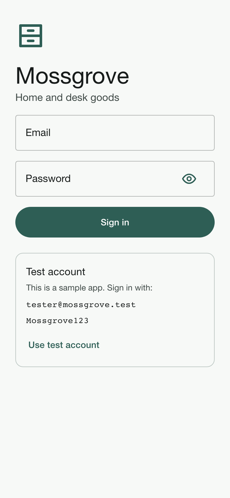 | 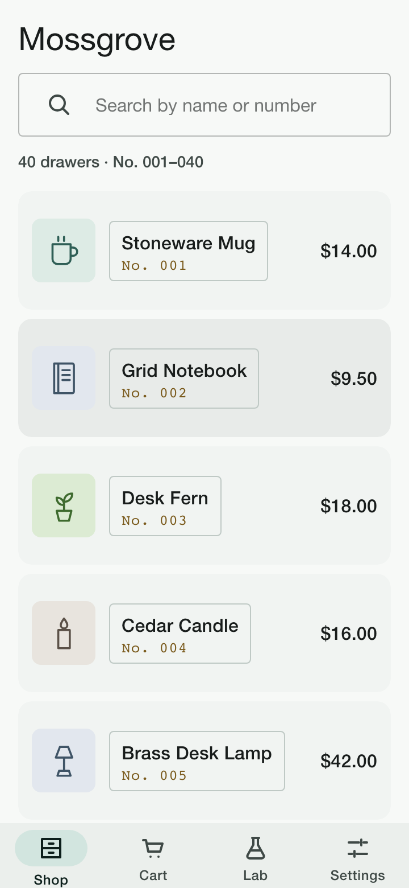 | 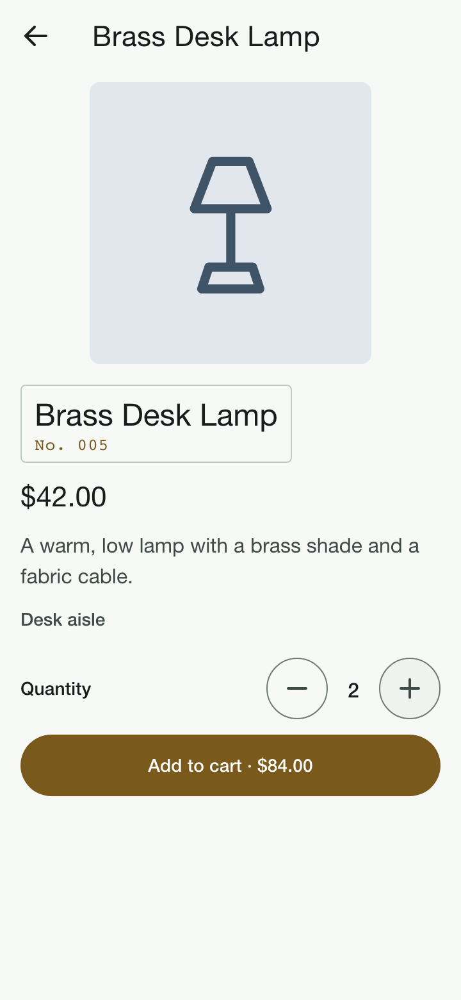 | 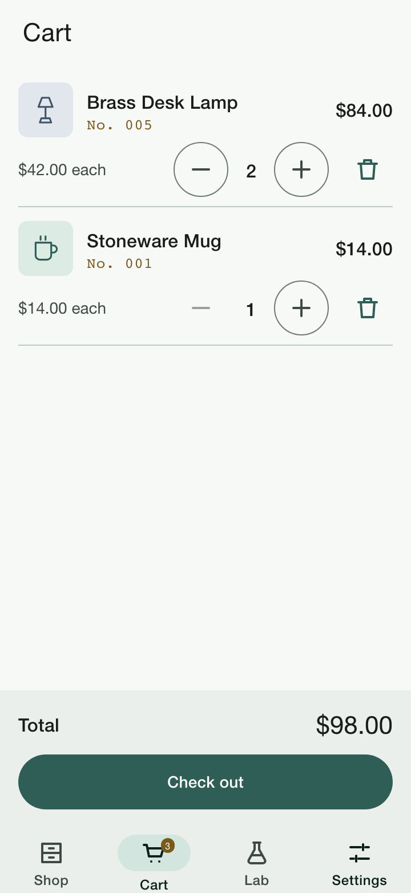 |
| Modal | Lab | Form errors | Form done |
| 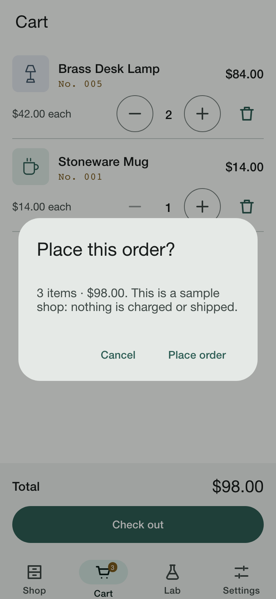 | 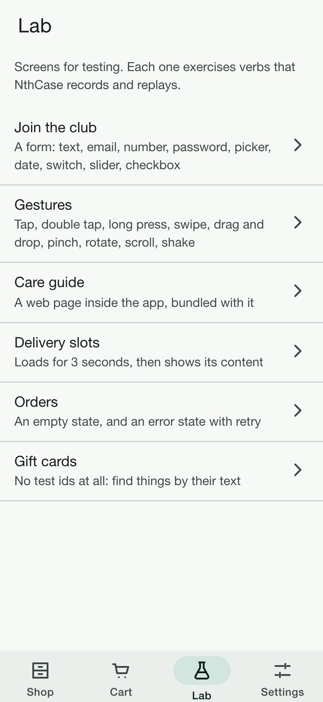 | 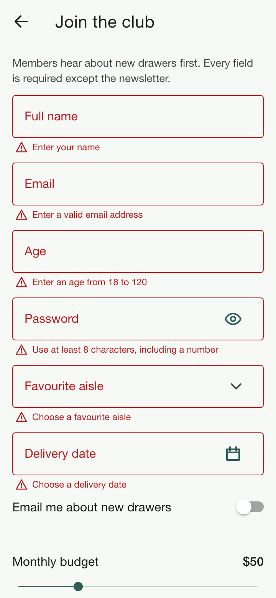 | 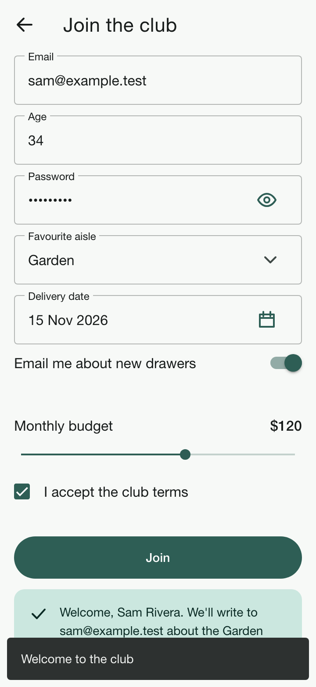 |
| Gestures | Care guide (iframe) | Error + retry | No test ids |
| 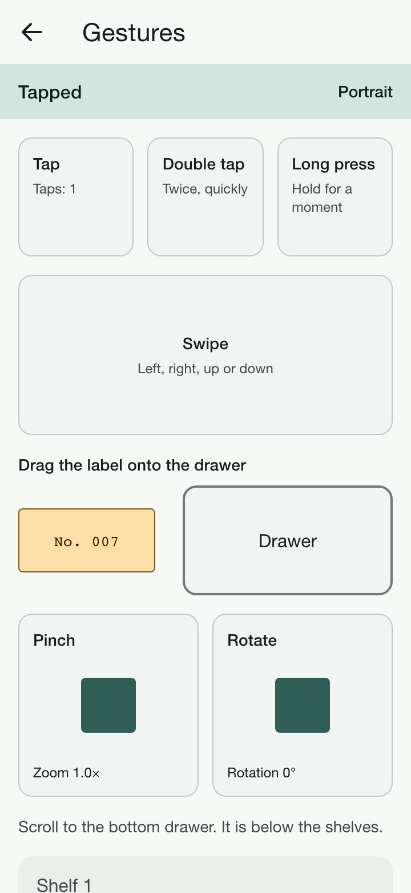 | 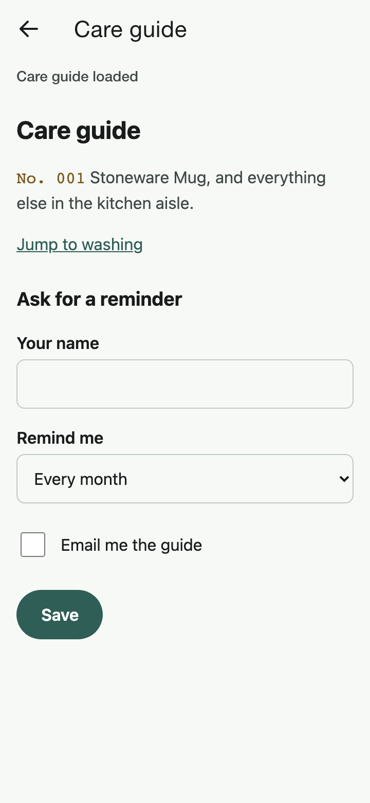 | 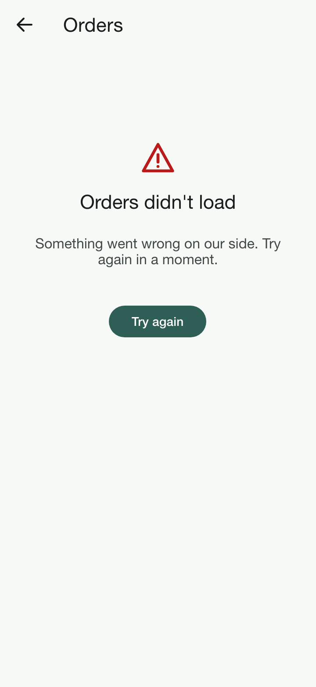 | 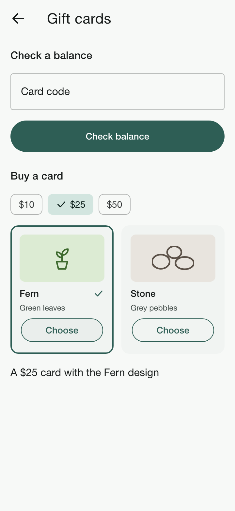 |
| Settings | Settings dialog | Dark | Deep link, unknown id |
| 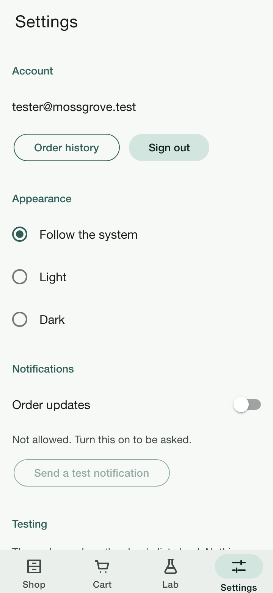 | 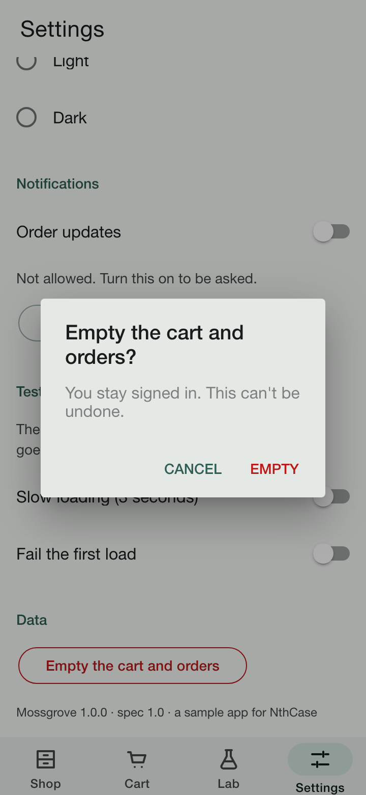 | 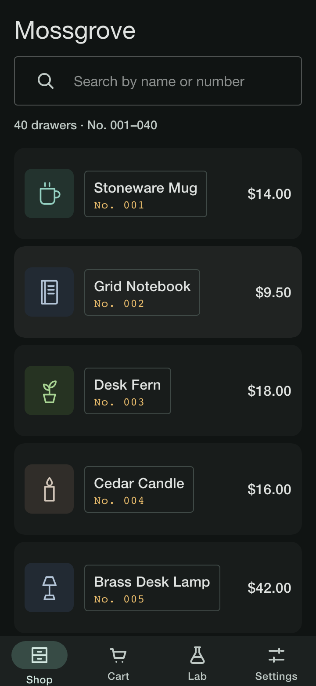 | 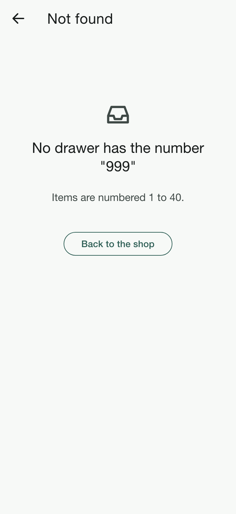 |

All 24 screens, light and dark, are in [docs/screenshots](docs/screenshots). Playwright draws them from the production
web build in Chromium at 360 × 780, in Material mode (the mode Android uses). **They show the web layer only**: what
the app's web view draws. The system notification prompt, the status bar and iOS-mode styling are not in them.

## Test account

| | |
| --- | --- |
| Email | `tester@mossgrove.test` |
| Password | `Mossgrove123` |
| Gift-card code | `MOSS-0025` |
| Deep link | `nthcase-sample://item/{1–40}` |
| App id / bundle id | `com.nthcase.sample` |

The account is printed on the sign-in screen too, with a **Use test account** button.

## Build

You need Node.js 24 (22.22 or newer), and for the apps the Android SDK with JDK 21, or Xcode 26.

```bash
npm ci
npm run build
npx cap sync
```

`npx cap sync` copies the web build into both native projects. They load it from inside the app: there is no
`server.url` and no live reload, so the apps run on their own.

```bash
cd android && ./gradlew assembleDebug
```

The APK is `android/app/build/outputs/apk/debug/app-debug.apk`, debug-signed, about 4.4 MB.

```bash
cd ios/App && xcodebuild -project App.xcodeproj -scheme App -configuration Debug -sdk iphonesimulator \
  -destination 'generic/platform=iOS Simulator' -derivedDataPath build/DerivedData \
  ARCHS="arm64 x86_64" ONLY_ACTIVE_ARCH=NO CODE_SIGNING_ALLOWED=NO build
```

The Simulator app is `ios/App/build/DerivedData/Build/Products/Debug-iphonesimulator/App.app` (arm64 and x86_64,
unsigned). Install it with `xcrun simctl install <udid> App.app`. Every [release](../../releases) has both ready-built.

| | |
| --- | --- |
| UI | Ionic React 9 (Ionic's components throughout; the mode follows the platform), React 19, TypeScript, Vite |
| Native | Capacitor 8; Android minSdk 26, target 36; iOS 17 and later, Swift Package Manager (no CocoaPods) |
| Navigation | the app's own back stack (no router package): a tab always opens at its first screen |
| Tests | Vitest + Testing Library in jsdom; Playwright in Chromium and WebKit against the production build |
| Android permissions | `POST_NOTIFICATIONS`, and `INTERNET` (see [No network](#no-network)) |

## Tests

```bash
npm run typecheck && npm run lint
npm test          # Vitest: logic, the flows of scenarios 01–10, the tab rule, the id census
npm run build
npm run e2e       # Playwright: every screen and every id in Chromium (light, dark) and WebKit; redraws docs/screenshots
```

`npm test` renders the app's real Ionic components in jsdom. It walks each scenario's steps and checks their texts.
It also renders every screen in the state the spec names and finds every id from
[nthcase/test-ids.json](nthcase/test-ids.json) there, and it checks that Gift cards has none. `npm run e2e` does the
same against the production build in a real browser engine, the care guide's frame included, with real mouse and touch
input. Playwright downloads its own browsers (`npx playwright install chromium webkit`).

## Test it with NthCase

1. Install the build on a test device: `adb install android/app/build/outputs/apk/debug/app-debug.apk`, or
   `xcrun simctl install <udid> App.app` on a simulator.
2. Connect the device to NthCase with the agent: `npx nthcase-agent@latest`. The NthCase docs, under *Your
   devices*, walk through it. Or use a cloud device.
3. In NthCase, add the app (`com.nthcase.sample`) and upload the build.
4. Create a scenario from one of the files in [nthcase/scenarios](nthcase/scenarios): its numbered lines are the
   steps, and each `Expect:` line is that step's check. Or record one: **Scenarios → New scenario → Record**.
5. Compile it, and run it.

## Test ids

Every control has a stable test id from one list shared by all five apps:
[nthcase/test-ids.json](nthcase/test-ids.json). The whole app is a web view, so an id is the HTML `id` **and**
`data-testid` of the element a person acts on. Appium reaches them in the **WEBVIEW context**, as `#shop_search` or
`[data-testid="shop_search"]`. Debug builds allow it on both platforms: Capacitor turns on Android's WebView debugging
and iOS's `isInspectable` in debug builds, and not in release builds.

Where the id sits on an Ionic component:

- **On the native element, when the component draws one in the page's own DOM.** `ion-input` does: the id is on its
  `<input>`, the element you type into (`#signin_email` is an `INPUT`). `ion-alert` and `ion-action-sheet` draw their
  buttons the same way, so the Settings dialog's buttons and the aisle picker's options carry their ids on
  `<button>`s.
- **On the component's own element, when its native control is inside a shadow root**: `ion-button`, `ion-toggle`,
  `ion-checkbox`, `ion-radio`, `ion-range`, `ion-tab-button`, `ion-item` and `ion-datetime`. CSS selectors and
  WebDriver's find do not enter shadow roots, so the outer element is the one Appium can reach, and a tap on it is a
  tap on its control. A disabled Ionic button says so with the `disabled` attribute on that element.
- **Texts and screens** carry their ids on plain elements the app draws (`<span id="cart_total">`, `<div
  id="shop_screen">`).
- **The snackbar and the checkout dialog** are drawn by the app (an Ionic modal with the app's own content), because
  `ion-toast` keeps its message inside a shadow root.
- **The care guide** is an `<iframe id="webview">` of the bundled [care-guide.html](public/care-guide.html), whose
  elements keep the page's own `web_*` ids. Switch into the frame to reach them.
- **Gift cards** has no `id` and no `data-testid` at all, not even the ones Ionic gives its inputs.

What the **NATIVE** context shows, which this repository has not checked on a device:

- **Android:** Chrome's WebView builds an accessibility tree from the page: buttons, text fields and texts with their
  labels. It may expose an element's HTML `id` as its `resource-id`, depending on the WebView version, and an id on an
  Ionic component's outer element may not be its own node there. Do not rely on `resource-id`; use the WEBVIEW
  context.
- **iOS:** WKWebView's accessibility tree has labels and texts, not HTML ids. Use the WEBVIEW context.

## What it covers

| NthCase verb | Where | Scenario |
| --- | --- | --- |
| launch, tap, type | sign in, search, every button | 01, 02 |
| scroll to an element, swipe | the 40-item list; the form; the gestures screen | 02, 04, 05 |
| doubletap, longpress, pinch, dragdrop | Lab › Gestures | 05 |
| slide, select | Lab › Join the club (slider, aisle picker, date picker) | 04 |
| rotate, lock, unlock, home, back | any screen | 06 |
| a web view | Lab › Care guide (a bundled page in an iframe) | 07 |
| waitFor, an error with retry, empty states | Lab › Delivery slots, Lab › Orders, Settings › Testing | 08 |
| a system permission prompt, a modal | Settings | 09 |
| a screen with no test ids | Lab › Gift cards | 10 |
| extract, startif / endif | the cart total; sign in only if asked | 03, 06 |
| deep link | `nthcase-sample://item/7` | 11 |

The full table, with every check type and the known gaps, is in [SPEC.md §8](SPEC.md#8-verb-coverage).

## How Ionic meets the spec

- **Settings** is built with the same Ionic components as every other screen. Ionic has no second UI toolkit, so
  there is no classic-toolkit screen in this app (SPEC.md §12).
- **The web view screen** is an `<iframe>` of the bundled page, inside the app's own web view.
- **Shake** reads the accelerometer through `@capacitor/motion`. On iOS, Capacitor's web view grants motion access
  itself (no prompt), after the tap that opens Gestures. The iOS Simulator has no accelerometer, and its Device ›
  Shake does not reach a web page, so shake works on an Android emulator or a real phone only.
- **Back:** the top bar's Back, Android's system Back (which first closes an open dialog) and a swipe from the left
  edge on iOS.
- **In a browser** (for development and the Playwright checks), the address `…/#item/7` stands in for the deep link.

### No network

The app makes no request. The web build is inside the app, and its Content-Security-Policy allows only the app's own
files: scripts, styles, frames and requests. The care guide has its own policy that allows nothing remote. On Android
the app keeps the `INTERNET` permission that Capacitor's template declares. Capacitor serves the app to its WebView
from `https://localhost` inside the app, and this repository has not shown that the app still loads without the
permission. The other permissions the notifications plugin asks for (exact alarms, boot, wake lock) are removed.

## Dependencies

What ships in the app:

| Package | Publisher |
| --- | --- |
| `@ionic/react`, `@ionic/core` | Ionic |
| `@capacitor/core`, `@capacitor/android`, `@capacitor/ios` | Ionic (Capacitor) |
| `@capacitor/app` (deep link, Android Back), `@capacitor/local-notifications` (the one prompt), `@capacitor/motion` (shake) | Ionic (Capacitor) |
| `react`, `react-dom` | Meta |
| pulled in by `@ionic/react`: `ionicons`, `@stencil/core`, `@stencil/react-output-target` | Ionic |
| pulled in by `@stencil/react-output-target`: `@lit/react` | Google (Lit) |
| pulled in by `react-dom`: `scheduler` | Meta |

Native: `capacitor-swift-pm` (Ionic) through Swift Package Manager, and AndroidX libraries (Google) through Gradle,
as Capacitor's templates declare them.

Test-only and build-only tools, which never ship in the app: Vite and `@vitejs/plugin-react`, TypeScript, ESLint
(`@eslint/js`, `typescript-eslint`, `eslint-plugin-react-hooks`, `globals`), Vitest, jsdom, Testing Library
(`@testing-library/react`, `dom`, `jest-dom`, `user-event`), Playwright and its browsers, and `@capacitor/cli`.
`scripts/convert-art.mjs` uses Playwright's Chromium to draw the iOS icon.

## Layout

```
src/                 the app: App.tsx (shell, tabs, snackbar, Back), screens/, data/ (catalogue, rules, store),
                     ui/ (shared parts), theme/, testIds.ts, platform.ts (Capacitor plugins)
src/art/             art.generated.ts, made from art/ by scripts/convert-art.mjs
public/              care-guide.html, the bundled page
tests/               Vitest: logic, flows, ids, timings
e2e/                 Playwright: the walk (screens, ids, screenshots) and real-input behaviour
android/  ios/       the native projects, as Capacitor generates them, with Mossgrove's icon, scheme and versions
scripts/             convert-art.mjs (art/ into the app and both platforms), ci-simulator-smoke.sh (CI only)
art/                 the original icons, product drawings and launcher mark (SVG), unchanged
nthcase/             test-ids.json and the scenarios
docs/screenshots/    every screen, light and dark
```

`npm run art` redraws `src/art/art.generated.ts`, Android's launcher and notification icons, and iOS's app icon and
launch image from `art/`.

## Licence

Apache-2.0, see [LICENSE](LICENSE) and [NOTICE](NOTICE). Mossgrove, its items and its drawings are fictional and were
made for these apps. "NthCase" is a trademark of Unidots Software Solutions LLC.
